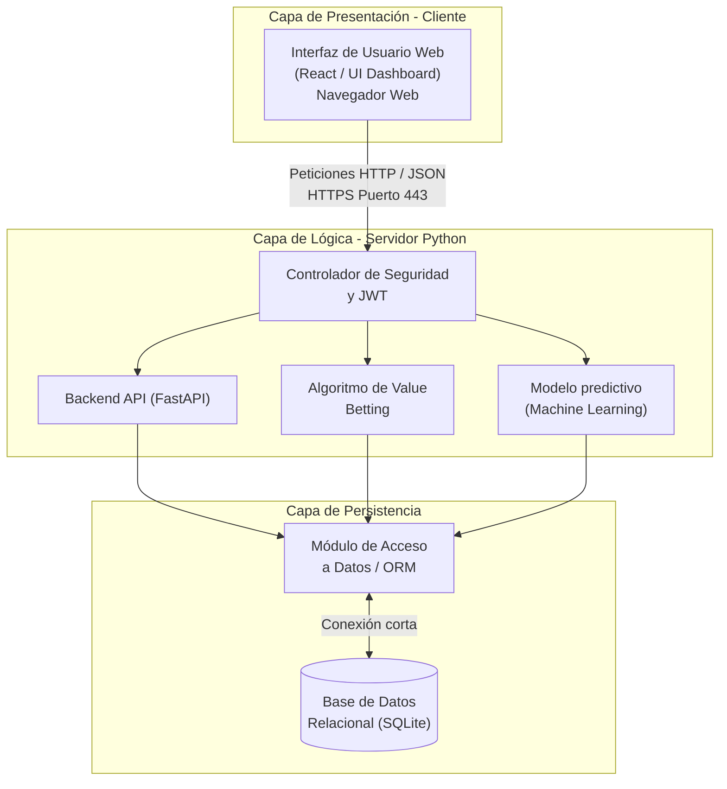

# Kellytix™ - Arquitectura del Sistema

## Descripción General de la Arquitectura

### 1. Presentación del Esquema

El sistema Kellytix está estructurado bajo un modelo de arquitectura de tres capas (Cliente, Servidor y Persistencia). Este diseño permite separar claramente la interfaz de usuario, la lógica de negocio (procesamiento matemático y de machine learning) y el almacenamiento de datos, garantizando que el sistema sea modular, seguro y fácil de mantener por el equipo de desarrollo.

### 2. Capa de Presentación - Cliente

Es el entorno de interacción directa con el usuario final.

*   **Interfaz de Usuario Web:** Desarrollada como un UI Dashboard interactivo (usando React).
*   **Entorno de Ejecución:** Navegador Web estándar.
*   **Comunicación de Red:** Todas las solicitudes se envían hacia el servidor mediante peticiones asíncronas **HTTP / JSON** a través del puerto seguro **HTTPS 443**.

### 3. Capa de Lógica - Servidor Python

Esta capa centraliza todo el "core" técnico y las reglas de negocio. Recibe las peticiones del cliente y orquesta los diferentes módulos.

*   **Controlador de Seguridad y JWT:** Actúa como el punto de entrada (middleware) validando la identidad del usuario y los tokens de seguridad antes de procesar cualquier solicitud.
*   **Backend API (FastAPI):** Módulo encargado de gestionar las rutas (endpoints) y la comunicación estructurada.
*   **Algoritmo de Value Betting:** Motor lógico que ejecuta las fórmulas matemáticas (como el Criterio de Kelly) para detectar apuestas de valor.
*   **Modelo Predictivo (Machine Learning):** Componente de inteligencia artificial que procesa los datos para generar probabilidades reales sobre los eventos deportivos.

### 4. Capa de Persistencia

Dedicada exclusivamente al almacenamiento, recuperación y gestión de la información del sistema.

*   **Módulo de Acceso a Datos / ORM:** Utiliza un Mapeador Objeto-Relacional (típicamente SQLAlchemy) para abstraer las consultas SQL. Es el único componente que interactúa directamente con los módulos de la capa lógica.
*   **Conexión:** Se establece mediante una **conexión corta** local.
*   **Base de Datos Relacional:** Se utiliza **SQLite** como motor de almacenamiento ligero y autocontenido para el MVP.

---

### 5. Diagrama de Componentes y Despliegue

A continuación se representa el flujo visual de la arquitectura implementada:

