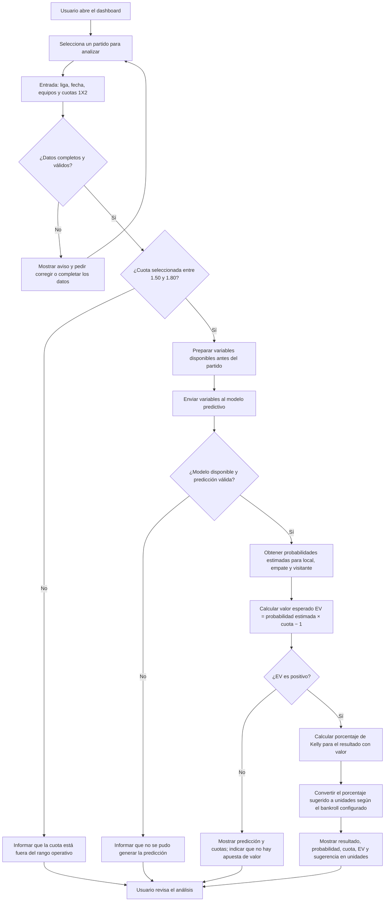

# Recorrido del usuario: detección de una apuesta de valor

Este diagrama describe el flujo previsto del MVP desde que el usuario solicita analizar un partido hasta que recibe una predicción. La entrada combina los datos disponibles del partido y las cuotas 1X2; el modelo estima probabilidades y el sistema las contrasta con el mercado antes de calcular una sugerencia de inversión.

El resultado es informativo: Kellytix presenta una recomendación en unidades y no ejecuta la apuesta. El diagrama representa la arquitectura propuesta, no una funcionalidad ya implementada.

## Datos de entrada y resultado

- **Entrada:** partido, liga, fecha, equipos y cuotas del mercado 1X2; se usan variables históricas disponibles antes del partido para evitar incorporar información posterior al resultado.
- **Evaluación:** el modelo estima la probabilidad de cada resultado. El motor compara esa probabilidad con la cuota seleccionada para calcular el valor esperado; para los casos con EV positivo, calcula el porcentaje Kelly.
- **Salida:** predicción, cuota evaluada, valor esperado e inversión sugerida en unidades. Si los datos no son válidos, la cuota queda fuera del rango operativo, falla el modelo o no hay EV positivo, se informa el motivo o la ausencia de una oportunidad.

El rango de cuotas de 1.50 a 1.80 y el uso de unidades siguen los objetivos y requisitos documentados del proyecto.
