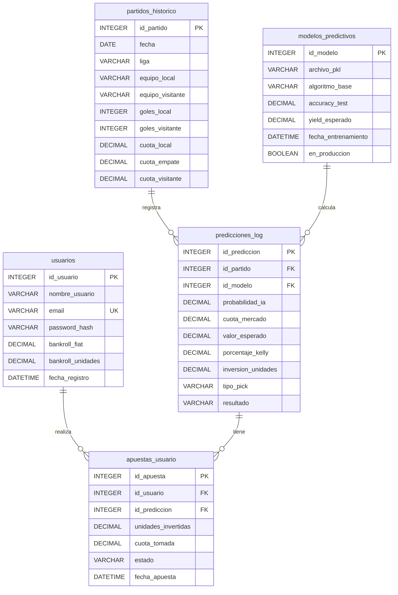

# Diagrama Relacional de la Base de Datos (Kellytix)

Este diagrama representa la estructura de la base de datos local SQLite utilizando SQLAlchemy, alineada a los requerimientos de la Fase 00 (MVP).

# Diagrama Relacional de la Base de Datos (Kellytix)

